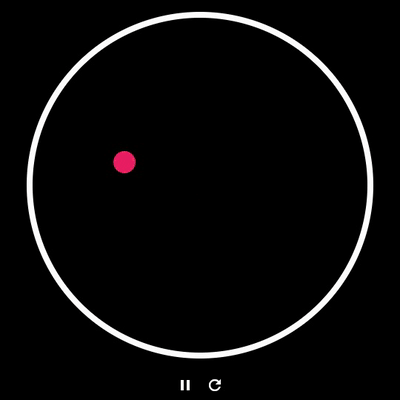

# Flutter Magic Balls

Bouncing balls inside a circular arena. Every time a ball hits the wall it may spawn another ball,
vanish, or simply bounce. Built with Flutter only, no external packages.

**[Try the web demo](https://sharmadhiraj.github.io/Flutter-Magic-Balls/)**



## Features

- Frame-rate independent movement driven by a single `Ticker`
- Elastic-style ball-to-ball collisions and reflection off the circular wall
- Random fate on every wall hit: create a ball, vanish, or nothing (weighted)
- Tap anywhere inside the arena to add a ball
- Pause and reset controls
- Haptic feedback on wall hits
- The arena border glows in the color of the ball that hit it

## Getting Started

```sh
git clone https://github.com/sharmadhiraj/Flutter-Magic-Balls
cd Flutter-Magic-Balls
flutter pub get
flutter run
```

Run the checks:

```sh
flutter analyze
flutter test
```

## Configuration

Everything tunable lives in [`lib/config.dart`](lib/config.dart): ball radius and speed, maximum
ball count, border width, glow duration, fate weights, and the color palette.

## Project Structure

```
lib/
  main.dart                  App entry point
  config.dart                Tunable constants
  models/                    Ball and BallFate
  arena/
    arena.dart               Simulation: movement, wall bounces, collisions, fates
    offset_math.dart         Small vector helpers (dot, reflect)
  screens/home.dart          Ticker loop, tap and button handling
  widgets/arena_painter.dart Draws the arena border and balls
test/                        Unit and widget tests
```

The simulation (`Arena`) has no widget dependencies, so it is easy to test. The screen advances it
on every frame, and `ArenaPainter` repaints from it without rebuilding any widgets.

## Roadmap

- Settings for speed, ball size and maximum count
- Sound effects

## Contributing

Issues and pull requests are welcome. Please run `flutter analyze` and `flutter test` before opening
a PR.

## License

[MIT](LICENSE)
